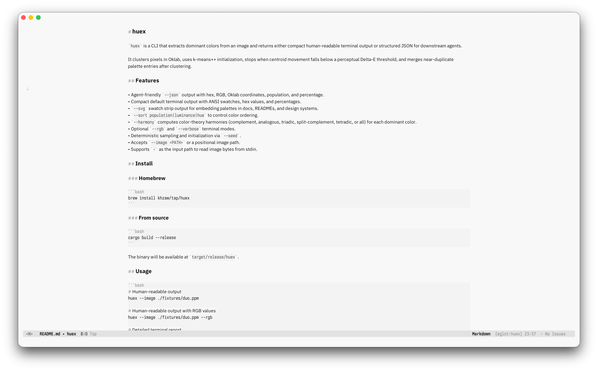
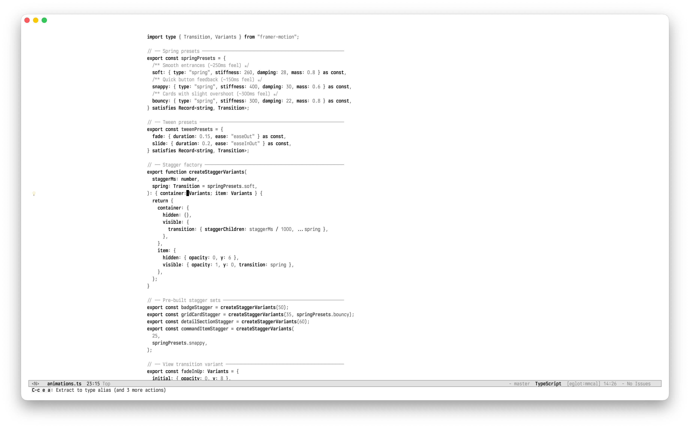
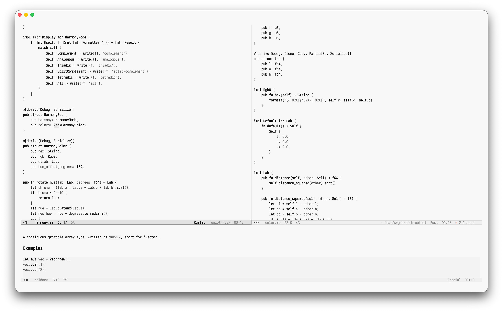
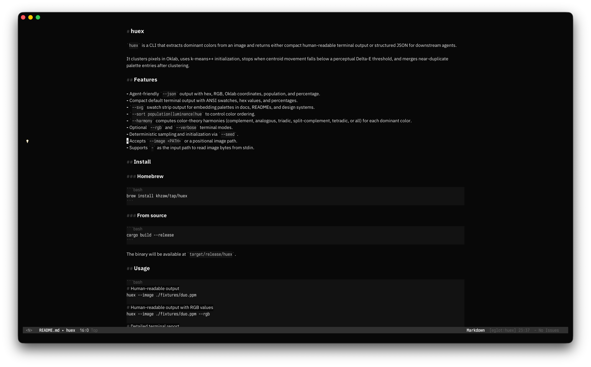
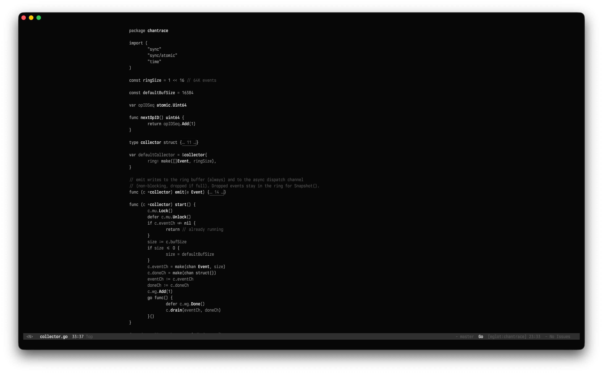
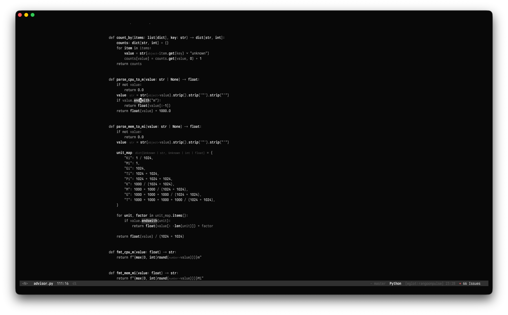
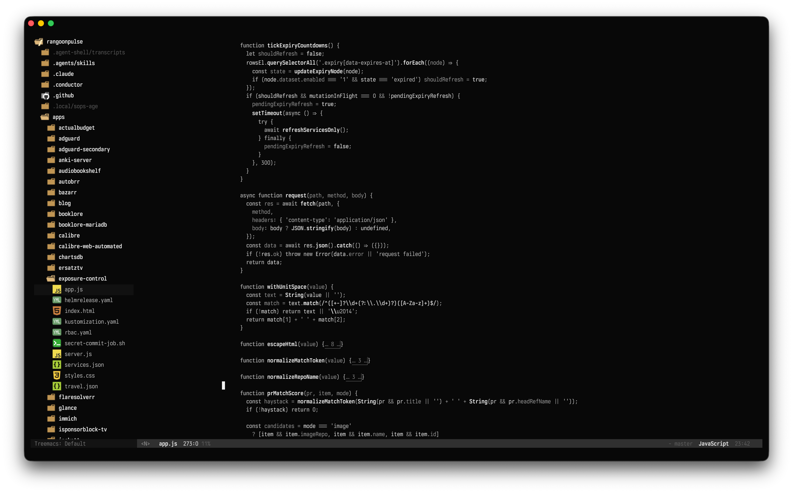
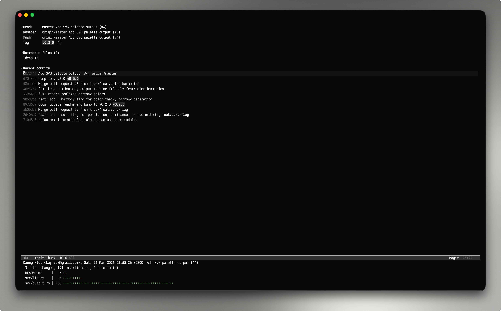
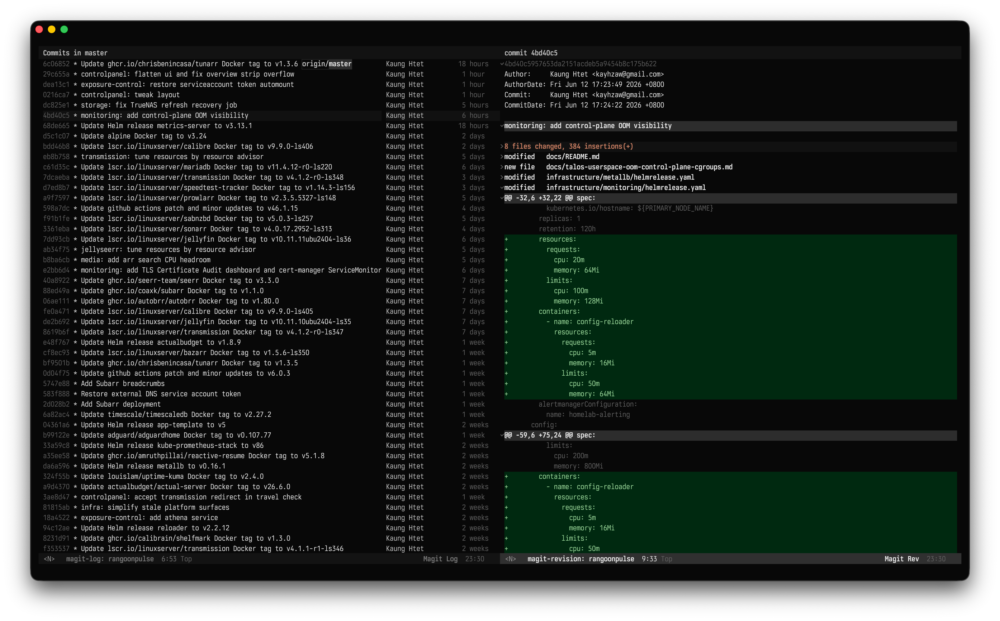
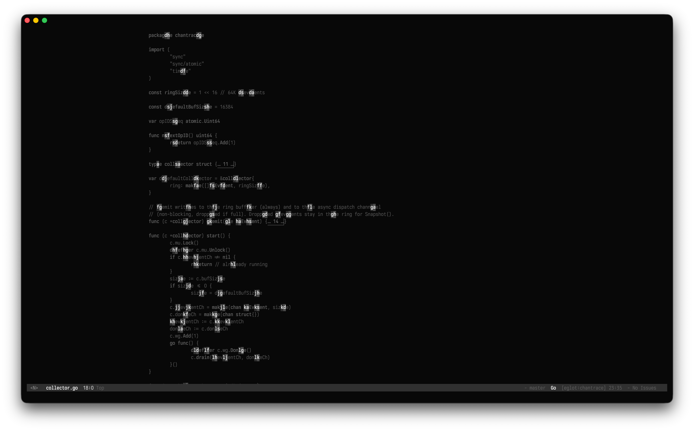

# Ivory themes

Ivory is a minimal, near-monochrome Emacs theme package with two variants:

- `ivory-light`
- `ivory-dark`

Most syntax contrast comes from font weight, foreground gray level, and
background shade.  Git and diff faces use red for removals and green for
additions.  Magit labels local branches with a blue background and remote
branches with a violet one.  The current branch has a green background and
border.

## Installation
### `use-package` with `:vc`

```elisp
(use-package ivory-themes
  :vc (:url "https://github.com/khzaw/ivory-themes.git"
       :rev :newest)
  :demand t
  :custom
  (ivory-themes-bold-constructs t)
  (ivory-themes-italic-constructs nil)
  :config
  (load-theme 'ivory-light t))
```

### Straight.el

```elisp
(use-package ivory-themes
  :straight (:type git
             :host github
             :repo "khzaw/ivory-themes")
  :demand t
  :custom
  (ivory-themes-bold-constructs t)
  (ivory-themes-italic-constructs nil)
  :config
  (load-theme 'ivory-dark t))
```

### Elpaca

```elisp
(use-package ivory-themes
  :elpaca (:host github
           :repo "khzaw/ivory-themes")
  :demand t
  :custom
  (ivory-themes-bold-constructs t)
  (ivory-themes-italic-constructs nil)
  :config
  (load-theme 'ivory-light t))
```

## Options

Set options before you load or reload a theme.

```elisp
(setq ivory-themes-bold-constructs t      ; bold syntax and content emphasis
      ivory-themes-italic-constructs nil  ; italics off
      ivory-themes-soft-backgrounds nil)  ; pure white or black editor background
```

| Option | Default | Effect |
| --- | --- | --- |
| `ivory-themes-bold-constructs` | `t` | Use bold for syntax and content emphasis.  Modelines, completion matches, Magit, diagnostics, and top-level headings stay bold either way. |
| `ivory-themes-italic-constructs` | `nil` | Allow italics in faces that usually use them.  When `nil`, the base `italic` and `bold-italic` faces are upright too, so Org and Markdown emphasis is upright. |
| `ivory-themes-soft-backgrounds` | `nil` | Use `#f8f8f8` instead of white in `ivory-light` and `#080808` instead of black in `ivory-dark`. |

Completion selections use a shaded background, and matched characters stay
bold.  Symbol overlays use gray backgrounds.  Overlays that reuse a gray also
get an underline.

In `ivory-dark`, definitions, calls, and types each have their own gray.
Definitions and types are bold when `ivory-themes-bold-constructs` is on.
Calls and builtins are always regular weight.  Eglot's semantic faces for
calls and assignments keep the font-lock weight instead of turning bold.
`ivory-light` uses one gray for definitions, calls, and types.

### Softened backgrounds

By default `ivory-light` uses a pure white editor background and `ivory-dark`
uses pure black.  Set `ivory-themes-soft-backgrounds` to `t` to use `#f8f8f8`
in `ivory-light` and `#080808` in `ivory-dark`.  `bg-alt`, `bg-subtle`, and
`bg-modeline-inactive` shift with it so they stay distinct from `bg`.

```elisp
(setq ivory-themes-soft-backgrounds t)
(ivory-themes-load 'ivory-light)
```

To toggle it without restarting Emacs:

```elisp
(ivory-themes-toggle-soft-backgrounds)
```

## Toggling between light and dark

```elisp
(ivory-themes-toggle)
```

## Palette system

Almost every color in Ivory is a gray, and the palette source writes each gray
as one number instead of a hex code.

A color has red, green, and blue channels, each from 0 to 255.  When all three
are equal, the color is a gray, so one number defines it.  `(gray 0)` is black,
`#000000`.  `(gray 255)` is white, `#ffffff`.  `(gray 138)` is `#8a8a8a`.  A
higher number is a lighter gray, so `(gray 146)` is a little lighter than
`(gray 138)`.

Colors that aren't gray, such as the red and green diff colors, are written as
hex.

In the default palette, the readable foreground roles have a contrast ratio of
at least 3:1 against `bg`.  The main text color, `fg`, is about 18.9:1 in
`ivory-light` and 18.1:1 in `ivory-dark`.  Comments, dimmed labels, completion
annotations, and inactive UI text are closer to 3:1.  With soft backgrounds on,
the faintest of these roles drop to about 2.9:1.

### Background levels

By default `ivory-light` sets `bg` to `(gray 255)` and `ivory-dark` sets it to
`(gray 0)`.  `bg-alt`, `bg-subtle`, and `bg-modeline-inactive` are 8 to 14
gray levels away from `bg`, so they stay visible next to a pure white or black
editor.

There are two ways to avoid a pure white or black background:

- Turn on `ivory-themes-soft-backgrounds`, described under
  [Options](#options).  It sets `bg` to `#f8f8f8` in `ivory-light` and
  `#080808` in `ivory-dark`, and moves `bg-alt`, `bg-subtle`, and
  `bg-modeline-inactive` with it.
- Override `bg` and the other background roles with your own colors.  See
  [Palette overrides](#palette-overrides).

Palette roles:

| Group | Roles |
| --- | --- |
| Backgrounds | `bg`, `bg-alt`, `bg-dim`, `bg-active`, `bg-subtle`, `bg-block`, `bg-hl`, `bg-region`, `bg-search`, `bg-modeline`, `bg-modeline-inactive` |
| Code backgrounds | `bg-code-block`, `bg-code-inline` |
| Branch labels | `bg-branch-current`, `bg-branch-local`, `bg-branch-remote`, `branch-current-border` |
| Foregrounds | `fg`, `fg-alt`, `fg-dim`, `fg-faint`, `fg-name`, `fg-definition`, `fg-call`, `fg-type`, `fg-syntax`, `fg-string`, `fg-comment`, `fg-comment-delimiter`, `fg-inactive` |
| UI structure | `border`, `cursor`, `modeline-accent` |
| Accents and ANSI roles | `red`, `red-faint`, `green`, `green-faint`, `yellow`, `blue` |
| Diff backgrounds | `bg-added`, `bg-added-faint`, `bg-removed`, `bg-removed-faint`, `bg-changed`, `bg-changed-faint` |
| Diff foregrounds | `fg-added`, `fg-added-intense`, `fg-removed`, `fg-removed-intense`, `fg-changed`, `fg-changed-intense` |

## Palette overrides

You can override palette roles in your configuration before you load or
reload a theme.  Override keys are the role names from `ivory-themes-palettes`.
Override values must be six-digit `#rrggbb` hex colors.  An unknown role name
signals an error.

For example, to change the light comment colors:

```elisp
(setq ivory-themes-light-palette-overrides
      '((fg-comment . "#8a8a8a")
        (fg-comment-delimiter . "#929292")))

(ivory-themes-load 'ivory-light)
```

To make the light diff backgrounds stronger:

```elisp
(setq ivory-themes-light-palette-overrides
      '((bg-added . "#d5f5df")
        (bg-removed . "#ffe0de")))

(ivory-themes-load 'ivory-light)
```

Put overrides for both variants in `ivory-themes-common-palette-overrides`.
Put overrides for one variant in `ivory-themes-light-palette-overrides` or
`ivory-themes-dark-palette-overrides`.  A variant override wins over a common
override for the same role.

## Screenshots
### Light mode

#### Markdown



#### TypeScript



#### Rust



### Dark mode

#### Markdown



#### Go



#### Python



#### JavaScript



#### Magit status



#### Magit log



#### Avy




## License

Ivory is licensed under the MIT License.  See [LICENSE](LICENSE).
